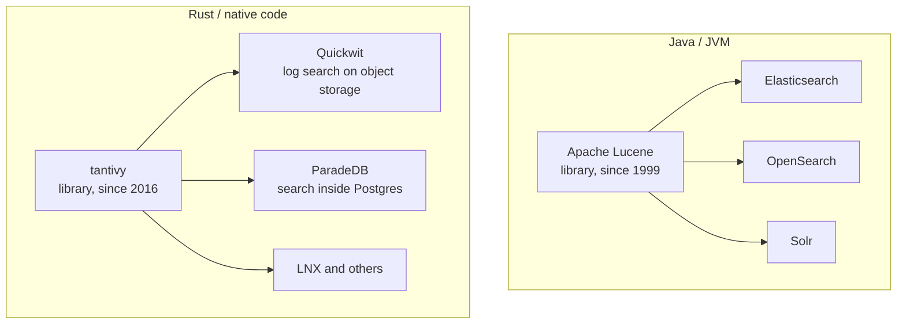
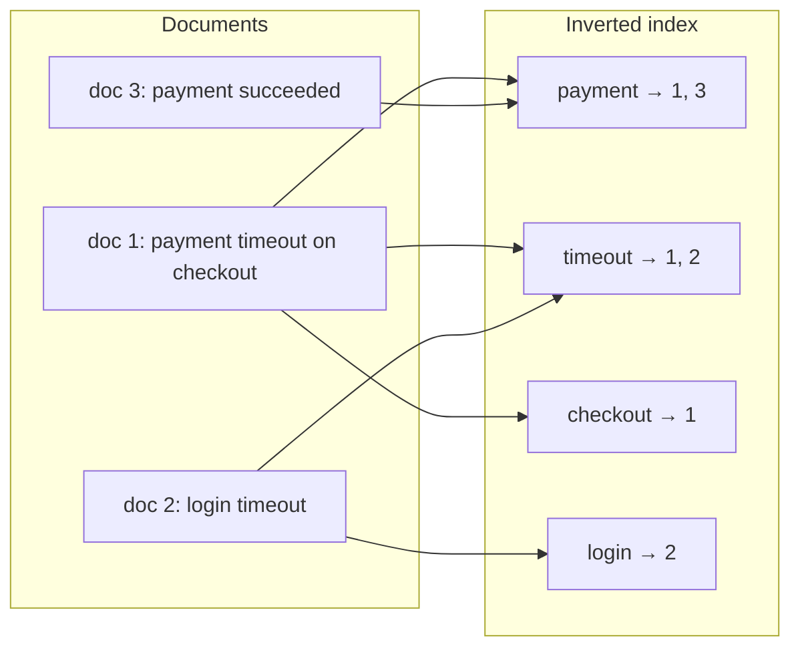
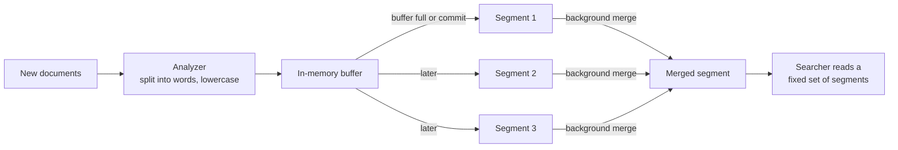
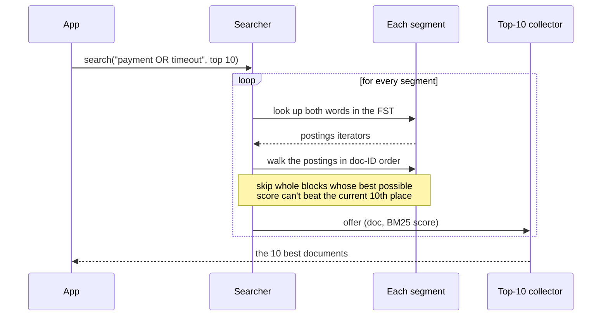
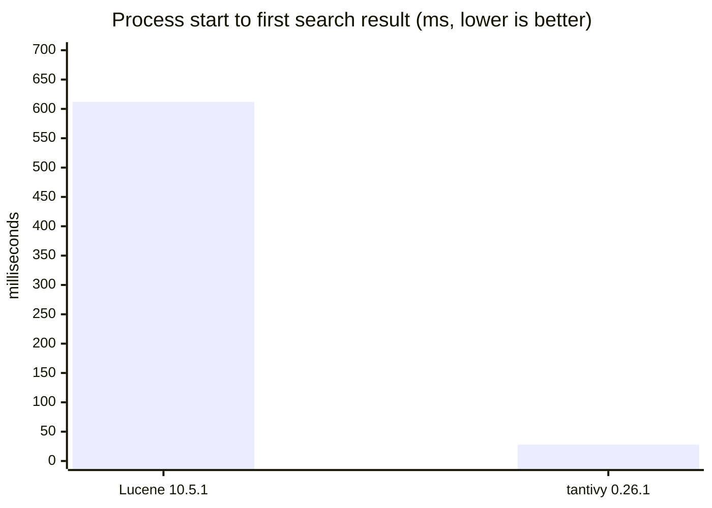
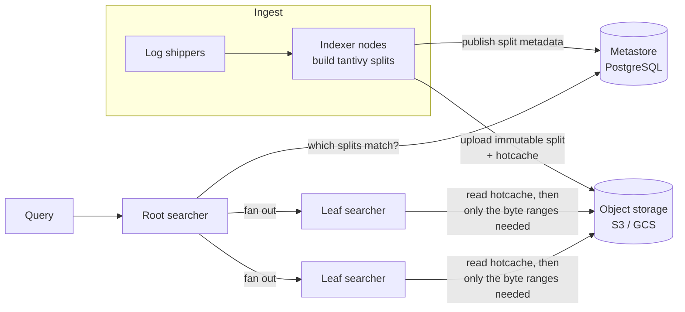
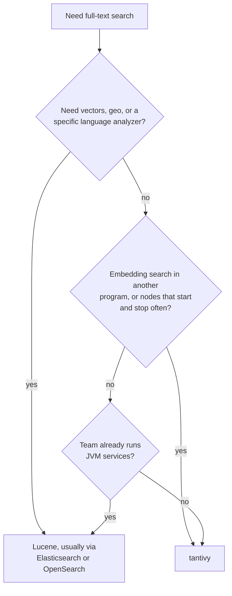

Say you run a service that writes a few million log lines a day, and you need
to answer "show me every request that failed with `payment timeout` in the
last hour" in well under a second. Scanning the raw logs with `grep` stops
being an option long before you reach that size. You need a full-text search
engine.

In practice that means one of two libraries. **Apache Lucene**, written in
Java, sits inside Elasticsearch, OpenSearch and Solr. **tantivy**, written in
Rust, sits inside Quickwit, ParadeDB and a growing list of newer systems.

The usual pitch is that tantivy is "Lucene, but in Rust, so it's faster". I
went in expecting to write that post. The current numbers tell a more
interesting story: the two engines are built almost the same way, raw speed
is now close to a draw, and Rust's real advantage shows up somewhere else.

## The big picture



Both are **libraries**, not servers. They handle indexing, compression and
query execution. Everything distributed (sharding, replication, a REST API,
cluster coordination) is the job of the product built on top. tantivy's
author has said its architecture deliberately follows Lucene's, and that Rust
changed how the code is organized more than the design itself.

So start with the design they share.

## How a full-text engine finds anything: the inverted index

A database index maps a row to its values. A search engine flips that around:
it maps every word to the list of documents that contain it. That list is a
**postings list**, and the whole structure is an **inverted index**.



The query `payment AND timeout` becomes "intersect the lists `[1, 3]` and
`[1, 2]`", which gives `[1]`. Real postings lists also store how often the
word appears in each document (for ranking) and the positions of each
occurrence (so `"payment timeout"` as an exact phrase can be checked). Ranking
uses **BM25**, a formula that scores rare words higher than common ones and
favours shorter documents.

Everything else in both engines exists to make this structure fast to build,
small on disk, and cheap to read.

## The shared architecture: immutable segments

Neither engine edits an index in place. New documents are collected in memory
and written out as a small, self-contained, **immutable** mini-index called a
**segment**. A search reads all segments and combines the results. In the
background, small segments are merged into bigger ones.



Immutability is the key design decision, and both engines made it for the
same reasons:

- **No locks on the read path.** A searcher holds a snapshot of the segment
  list. Writers never touch a segment it is reading.
- **Aggressive compression.** A file that never changes can be packed
  tightly, because nothing has to be updated in place.
- **The operating system does the caching.** Both engines memory-map their
  files (`mmap`), so the OS page cache keeps hot parts in RAM and the engine
  needs no cache of its own for them.

A delete doesn't remove anything immediately. It marks the document in a
small "deleted docs" bitmap, and the space comes back when the segment is
next merged. An update is a delete plus an add.

## Inside a segment

A segment is a handful of files, each holding one kind of data. The tantivy
names below are the files it wrote for the benchmark index later in this
post; the Lucene names are its standard file extensions:

| What it stores | Lucene 10.5 | tantivy 0.26 |
|---|---|---|
| Term dictionary: word → where its postings start | `.tim` / `.tip` (a block tree with an FST index) | `.term` (an FST) |
| Postings: doc IDs and frequencies | `.doc` | `.idx` |
| Positions, for phrase queries | `.pos` | `.pos` |
| Column store, for sorting, facets and aggregations | doc values (`.dvd`) | fast fields (`.fast`) |
| Field lengths, for BM25 | norms (`.nvd`) | `.fieldnorm` |
| The original documents | stored fields (`.fdt`) | `.store` |
| Which segments exist | `segments_N` | `meta.json` |

(For the benchmark index, Lucene packed all of these into a single compound
`.cfs` file, which it can do to keep the number of open files down.)

Two structures are worth understanding, because the speed debate is really
about them.

**The term dictionary is an FST.** A finite state transducer is a compressed
automaton that shares both prefixes and suffixes between words, a bit like a
trie that is also compressed from the end. Both engines use one to go from a
word to its postings in a few memory reads, and it makes prefix and fuzzy
queries cheap.

**Postings are compressed in blocks.** Doc IDs are stored as gaps between
consecutive IDs (`3, 7, 12` becomes `3, 4, 5`), and each block of gaps is
bit-packed using only as many bits as the largest gap needs. tantivy uses
blocks of 128 documents. Lucene 10.4 uses blocks of 256, and stores very dense
blocks as plain bitsets instead. Small fixed-size blocks matter because the
CPU can decode them with SIMD instructions, many values at a time.

## Answering a query

Here is what happens for a top-10 search like `payment OR timeout`:



The note in the middle is where the real engineering is. A common word like
`timeout` may match millions of documents, but you only want ten. Both
engines store, for every block of postings, the best score any document in
that block could reach. Once the collector holds ten good results, any block
whose best possible score is lower than the current tenth place is skipped
without decoding it.

The two engines implement this differently. tantivy uses **block-max WAND**,
which re-decides per document which terms are worth checking. Lucene uses
**block-max MAXSCORE**, which decides per block. WAND can skip more, but does
more work per decision. Neither is better everywhere, and as the benchmarks
show, this choice moves results more than the language does.

## The one architectural difference you'll feel: when writes become visible

| | Lucene | tantivy |
|---|---|---|
| Make new documents searchable | Near-real-time: open a reader from the `IndexWriter` and see changes without a durable commit | Only after `commit()`, then the reader reloads |
| Cost of making documents visible | A cheap in-memory flush | A full commit to disk |

This is why Elasticsearch can refresh every second without fsyncing every
second. With tantivy, the system on top batches writes and commits on a
schedule. Quickwit, for example, commits on a configurable interval.

## Feature coverage is not close

| | Lucene | tantivy |
|---|---|---|
| Full-text search, BM25, phrases, fuzzy, prefix | Yes | Yes |
| Facets and aggregations | Yes | Yes (Elasticsearch-style aggregations) |
| Numeric and range queries | Yes (BKD trees) | Yes (fast fields) |
| Vector / approximate nearest-neighbour search | Yes (HNSW) | No built-in support |
| Geo search | Yes | Was still an open pull request as of April 2026 |
| Language analyzers | Dozens, built in | A smaller set, plus community add-ons |
| Ecosystem | 25+ years: Elasticsearch, OpenSearch, Solr, plugins | Younger, growing fast |

If you need vector search, geo or a specific language analyzer today, Lucene
probably wins before speed comes into it.

## So is Rust faster? What the benchmarks actually say

The well-known comparison is
[Search Benchmark, the Game](https://github.com/quickwit-oss/search-benchmark-game),
maintained by the tantivy team. It runs real AOL search queries against an
English Wikipedia export, single-threaded, with everything in memory. A few
years ago it showed tantivy roughly twice as fast as Lucene, and that is
where the "Rust is 2x faster" line comes from.

Then Lucene's developers studied why. Adrien Grand, a Lucene committer, wrote
up what he found, and almost none of it was "Java is slow":

- **Counting.** tantivy counted matches with the CPU's `popcount` instruction
  over a bitset instead of visiting each match. Lucene adopted the idea.
- **Auto-vectorization.** Rust's compiler (LLVM) turned one hot loop into SIMD
  code automatically; Java's JIT compiler didn't. Lucene restructured the
  loop so the JIT could.
- **Simpler skip data.** Lucene had 10 levels of skip pointers; tantivy has
  one. Lucene moved to 2 and got faster, because simpler code runs faster.
- **Virtual calls.** Lucene's flexible query classes made some hot calls
  impossible for the JIT to inline. Lucene narrowed them.

Each change was a double-digit percentage win on some query type, and his
conclusion was that the gap came from algorithms and code structure, not the
language. By Lucene 10.3 he reported Lucene on par with tantivy on most
queries.

I pulled the raw results file from the benchmark repository (last updated
31 May 2026: Lucene 10.4.0 against tantivy 0.26) and computed the medians per
query type myself, in microseconds, top-10 results:

| Query type | Lucene 10.4 | tantivy 0.26 | Faster |
|---|---:|---:|---|
| Two-word AND | 120 | 126 | About even |
| Two-word OR | 120 | 195 | Lucene |
| Three-word OR | 305 | 772 | Lucene, by 2.5x |
| Two-word phrase | 232 | 202 | tantivy |
| Three-word phrase | 594 | 437 | tantivy |
| Queries with NOT | 255 | 160 | tantivy |
| All queries | 171 | 257 | Lucene |

On exhaustive work (top-100 plus an exact count of every match) tantivy is
ahead, with a median of 585 µs against Lucene's 629 µs. On ranked top-10
search, the most common case, Lucene is now faster overall.

So raw query speed is no longer a reason to pick tantivy. Both engines keep
borrowing each other's tricks, and whoever is ahead on a given query type
this year may not be next year.

## Where Rust really wins: the process, not the query

The benchmark game measures a warmed-up engine answering queries. It doesn't
measure what it costs to **get** to a warmed-up engine, or how much memory you
need to keep one around. That's where the JVM shows.

I measured that myself. Same synthetic corpus (500,000 documents of 60 words,
with word frequencies that follow a Zipf curve like real text), same 400
queries, same tokenization, and I checked that both engines return identical
match counts for every query. Each engine ran in Docker with the same limits
of 2 CPUs and 4 GB of memory, with Lucene's SIMD support turned on and both
given 50 warm-up passes before measuring.

| | Lucene 10.5.1 (Java 21) | tantivy 0.26.1 (Rust) |
|---|---:|---:|
| Process start to first search result | 599–645 ms | 28–43 ms |
| Peak memory while searching | 205–212 MB | 44 MB |
| Indexing 500k docs, one thread | 17.4–18.1 s | 9.2–11.3 s |
| Peak memory while indexing | 261–275 MB | 147 MB |
| Index size | 58.5 MB | 62.6 MB |



The startup gap is the JVM starting, loading classes and running cold code in
the interpreter before the JIT compiles it. Both numbers include the index pages
each process had mapped into memory, so most of the memory gap is the JVM's
own footprint: heap headroom, JIT-compiled code and garbage collector
bookkeeping. tantivy is a native library, so it carries none of that.

In this test tantivy was also faster on warm queries (median 34 µs against
65 µs for AND queries). Read that with care: it's a synthetic corpus on a
laptop, and the Wikipedia benchmark above is the better guide to query speed.
The startup and memory gaps are structural, though, and don't depend on the
corpus.

### Why that matters: two real systems

A 600 ms startup and a 200 MB floor sound minor for one long-running server.
They become decisive in two kinds of design.

**1. Search nodes that come and go: Quickwit.** Quickwit is a log search
engine that keeps its indexes on S3-style object storage instead of local
disks. Datadog acquired it in January 2025.



Each piece of the index (a **split**) is a tantivy index packed into one
file, plus a small "hotcache" of the metadata needed to open it. A searcher
reads the hotcache, then fetches only the byte ranges the query touches.
Quickwit's docs put opening a split from S3 at about 60 ms. Because the data
lives in object storage, searcher nodes hold no state, so you can add ten of
them for a spike in queries and remove them afterwards.

That only pays off if a new searcher is useful almost immediately and cheap to
run. A process that answers its first query in about 30 ms and idles at tens
of megabytes fits that model. One that needs a JVM warm-up and a few hundred
megabytes of baseline per node fits it much less well.

**2. Search inside another program: ParadeDB.** ParadeDB's `pg_search`
extension puts a tantivy index inside PostgreSQL, so you can run BM25 search
from SQL and the index stays in step with the table, with no separate search
cluster to keep in sync.

PostgreSQL extensions are native code loaded into Postgres's own processes,
and Postgres runs one process per connection. A Rust library slots in like
any other native code. Embedding Lucene would mean starting a JVM inside
those processes, or running it as a separate service, which brings back the
cluster you were trying to avoid. This is my reading of the design rather
than something ParadeDB states, but it's the reason a Rust engine is the
natural fit here.

The same property lets tantivy run as a Python library, a CLI tool, or a
small single-binary service, with no runtime to install.

## When to pick which



**Pick Lucene** (usually through Elasticsearch or OpenSearch) when you need
breadth: vector search, geo, many languages, mature tooling, near-real-time
updates out of the box, or a large pool of engineers who already know it.

**Pick tantivy** when the search engine has to live inside something else
(a database, a Python app, a CLI tool), when nodes start and stop often, or
when memory per node is what you pay for. Expect to build more of the
surrounding system yourself, or use one that already exists, like Quickwit
or ParadeDB.

**Don't pick either for speed alone.** On today's benchmarks they trade
wins by query type.

## The takeaway

Lucene and tantivy are the same idea built twice: immutable segments, an FST
term dictionary, block-compressed postings, and block-max pruning for top-k.
The "Rust is 2x faster" story was really "tantivy had a few better algorithms",
and Lucene adopted most of them. What Rust does give tantivy is something a
query benchmark can't see: a search engine that starts in milliseconds, runs
in tens of megabytes, and drops into any other program. Quickwit and ParadeDB
are both built on that.

## Try it yourself

The benchmark code (a Java program, a Rust program and a corpus generator)
is in
[`code/lucene-vs-tantivy`](https://github.com/Chaitanya-0310/Chaitanya-0310.github.io/tree/main/code/lucene-vs-tantivy)
in this blog's repository. It needs Python 3 and Docker:

```bash
python3 gen_corpus.py   # writes data/corpus.tsv (500k docs) and data/queries.tsv
./run.sh                # builds both engines in Docker, indexes, runs 3 search passes
```

Setting `CHECK=1` on a search run prints the match count for every query
instead of timing it, which is how I confirmed both engines agree.

My setup: Intel Core i9-9980HK laptop, Docker 29.8 with each container limited
to 2 CPUs and 4 GB, OpenJDK 21.0.13, Rust 1.100.0, Lucene 10.5.1 and tantivy
0.26.1. Your absolute numbers will differ; the ratios should be close.

## Sources

- [Search Benchmark, the Game](https://github.com/quickwit-oss/search-benchmark-game): benchmark code and raw `results.json` (Lucene 10.4.0, tantivy 0.26; results updated 31 May 2026).
- Adrien Grand, [Why is Tantivy faster than Lucene?](https://jpountz.github.io/2025/04/12/why-is-Tantivy-faster-than-Lucene.html) (2025, updated Nov 2025) and [An analysis of Search Benchmark, the Game](https://jpountz.github.io/2025/05/12/analysis-of-Search-Benchmark-the-Game.html) (2025).
- [A Conversation with Paul Masurel, Creator of Tantivy](https://www.paradedb.com/blog/tantivy-interview), ParadeDB (April 2026).
- [Quickwit architecture](https://quickwit.io/docs/overview/architecture) and [Quickwit 101](https://quickwit.io/blog/quickwit-101).
- [Datadog acquires Quickwit](https://www.datadoghq.com/blog/datadog-acquires-quickwit/), Datadog (January 2025).
- [pg_search: Elastic-quality full-text search inside Postgres](https://www.paradedb.com/blog/introducing-search), ParadeDB.
- [Lucene Core news](https://lucene.apache.org/core/corenews.html) (Lucene 10.5.1, August 2026) and [tantivy 0.26.1 docs](https://docs.rs/tantivy/0.26.1).
