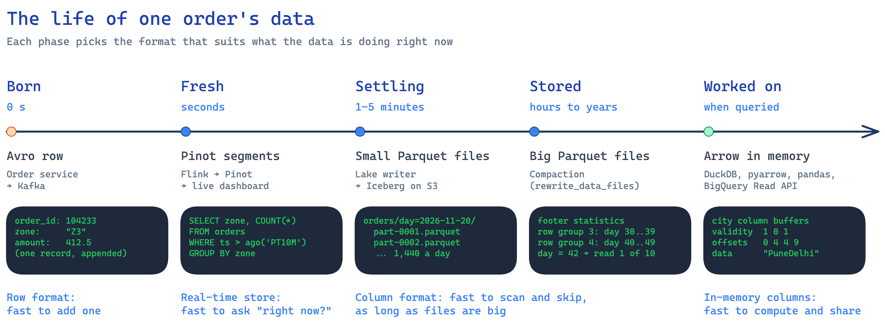
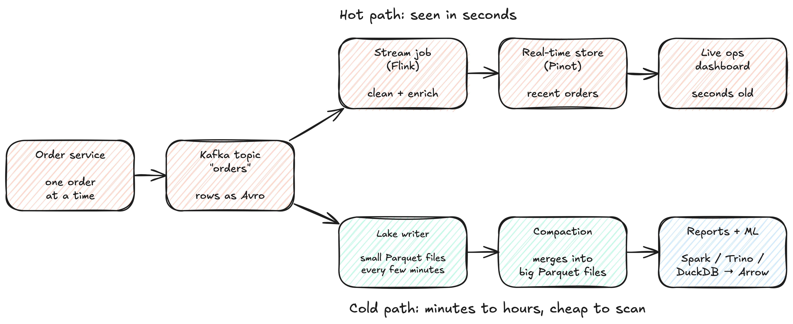
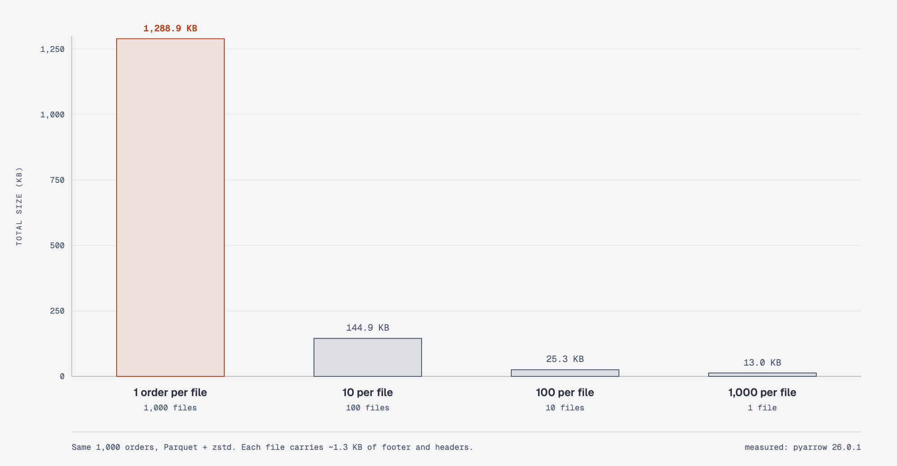
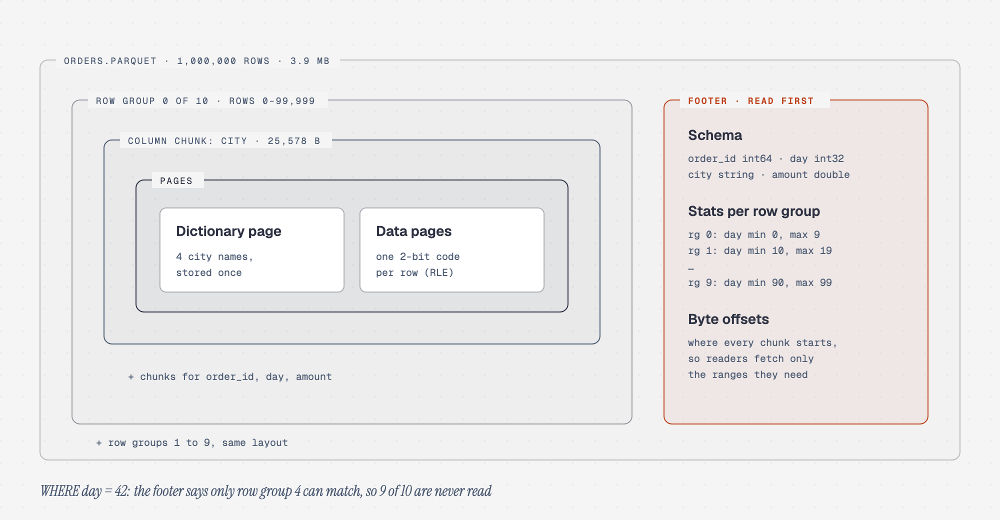
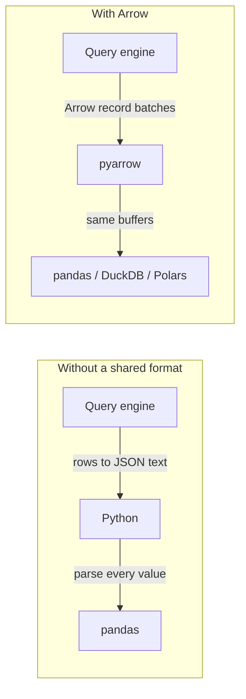
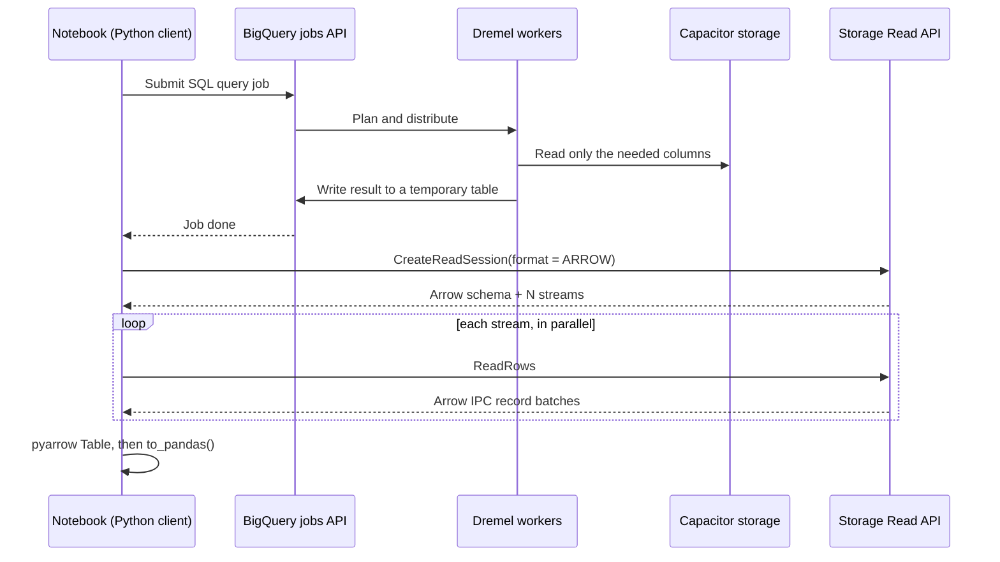
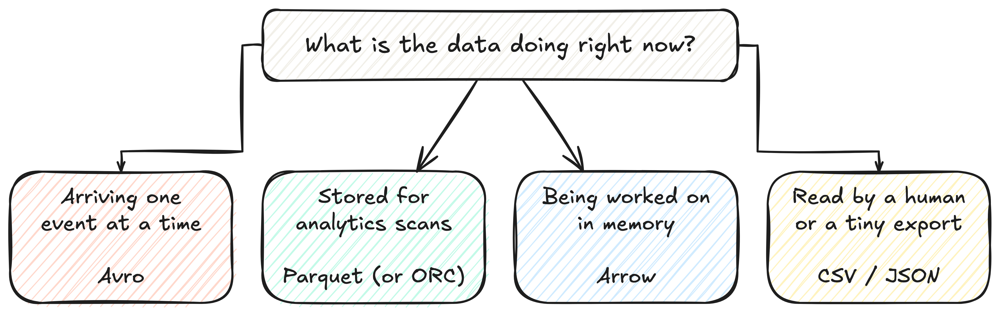

It is 12:31 on a weekday in Pune. Someone opens a food-delivery app, orders a
thali for ₹412.50, and taps *Place order*. Order number 104233 now exists.

Three different teams care about that order, and they want very different
things from it:

- **Ops** wants to see it on a live dashboard within a few seconds, so they
  know which zones are busy right now.
- **Finance** wants it included in next month's revenue report, along with
  every other order ever placed.
- **Data science** wants it as one row among millions in a pandas DataFrame,
  to train a model that predicts delivery times.

For weeks I thought "Arrow vs Parquet" was a choice between two formats. It
isn't. Following this one order through a data platform showed me that
**they're used at different stages of the same journey**, alongside a couple
of other formats. Each stage uses the one that fits what the data is doing at
that moment.

The company in this story, *Dabba*, is made up. Its architecture is not: it
follows the pattern Uber describes for Uber Eats, and the Arrow part is how
Google BigQuery hands data to Python. Every number in this post comes from
code I ran, which is included so you can run it too.

## The map

Here is the whole journey on one page. The rest of the post walks along it
from left to right.



The rule I took away is printed under the timeline: **pick the format by what
the data is doing right now**. A row format is fast to add one record to. A
column format is fast to scan and to skip through. An in-memory column format
is fast to compute on and to pass between programs.

## Chapter 1: Born, as one row in a log

When the order is placed, the order service doesn't write a file anywhere. It
publishes one event to a Kafka topic called `orders`, encoded as **Avro**.

Kafka is an append-only log: new records always go on the end, and many
different readers can each read it at their own pace. Avro suits this job
because it is a **row format**. Each order is written as one compact binary
record. Adding a record means appending its bytes, with no footer or statistics
to rewrite. Think of a post office's sorting tray: a new letter just goes on top.

From this one log, the order now travels down two paths at the same time.



## Chapter 2: Fresh, for the people watching right now

On the **hot path**, a Flink job reads each event a moment after it lands. It
drops broken events and adds context, such as the restaurant's name and the
delivery zone. The enriched events go into **Apache Pinot**, a database built
to answer questions like "orders per zone in the last 10 minutes" in
milliseconds. The ops dashboard asks Pinot every few seconds, so order 104233
appears on screen within a few seconds of being placed.

This is close to what Uber has published about its own stack: a FlinkSQL job
reads a Kafka topic and writes another Kafka topic, which Pinot ingests. Uber
Eats' Restaurant Manager dashboards run on Pinot. Uber also lets curated
offline data overwrite inconsistent real-time data. The fast path is allowed
to be slightly wrong, because the slow path corrects it later.

Pinot is the right tool for "right now". It is the wrong place to keep five
years of history, because fast servers and indexes are expensive per gigabyte.
History goes down the other path.

## Chapter 3: Settling, and the trap I would have walked into

The **cold path** writes orders into a data lake on cheap object storage, as
**Parquet** files in an Iceberg table. Parquet is a column format. It's
excellent for analytics, and it was my first instinct for everything. My
naive plan was: *every time an order arrives, write it as its own Parquet
file.*

So I tested it. One order holds about 26 bytes of real data (an 8-byte id, a
4-byte day, about 6 bytes of city name and an 8-byte amount). I wrote 1,000
orders two ways: one file per order, and all 1,000 in one file.

```python
# code/small_files.py (excerpt)
for o in orders:   # A: one file per order
    pq.write_table(pa.Table.from_pylist([o], schema), f"one_per_order/{o['order_id']}.parquet")
pq.write_table(pa.Table.from_pylist(orders, schema), "batched.parquet")   # B: one file
```

```
raw data per order       : ~26 bytes
one-order Parquet file   : 1304 bytes
1000 one-order files     : 1289 KB total, write 1372 ms, read 216 ms
1 file with 1000 orders  : 13 KB total, write 1.5 ms, read 2.1 ms
```

The timings vary between runs (writing the 1,000 files has taken 1.4 to
2.9 seconds), but the sizes don't. **A 26-byte order became a 1,304-byte
file.** I had pictured a Parquet file as "just the data", and that picture was
wrong.

What finally made sense of it was a courier parcel. Send a 5-gram ring by
courier and the parcel weighs 200 grams: box, bubble wrap, shipping label,
invoice. The packaging is the same size no matter how small the item is.
Every Parquet file carries its own packaging too. In this file, 933 bytes
are the **footer** (the schema, plus statistics for every column) and 359
bytes are column chunks, mostly per-column headers. The footer's size depends
on the number of **columns**, not rows. One order per file means paying for
the packaging 1,000 times.

Batching spreads that cost across many rows:



```
    1 orders/file ->  1000 files, total  1288.9 KB
   10 orders/file ->   100 files, total   144.9 KB
  100 orders/file ->    10 files, total    25.3 KB
 1000 orders/file ->     1 files, total    13.0 KB
```

This mistake has a name, **the small-files problem**, and it's one of the most
common ways a first data lake goes wrong. It's also why the platform has two
paths. To fill a big file you have to wait, and the ops dashboard can't
wait. So the dashboard reads from the hot path, and the lake is allowed to
take its time.

## Chapter 4: Stored, as big files that are cheap to skip

In practice, the lake writer flushes whatever has arrived every few minutes.
Those files are still smallish. A **compaction** job then runs about every
hour and rewrites many small files into a few big ones. In Iceberg that is the
`rewrite_data_files` procedure. The table's target file size,
`write.target-file-size-bytes`, defaults to 512 MB.

Big files are where Parquet's design starts to pay off. Here is what's inside
a file of a million Dabba orders:



- The rows are split into **row groups** (100,000 rows each here).
- Inside each row group, every column is stored separately as a **column
  chunk**, so a query that needs only `amount` never reads `city`.
- The `city` chunk uses **dictionary encoding**: the four city names are stored
  once, and each row stores only a tiny code. That's why 100,000 city values
  take 25,578 bytes.
- The **footer** is read first. It holds the min and max of every column in
  every row group, and where each chunk starts in the file.

```python
# code/internals.py (excerpt)
pq.write_table(table, "orders.parquet", compression="zstd", row_group_size=100_000)
kept = frags[0].split_by_row_group(ds.field("day") == 42)
```

```
rows: 1000000 | row groups: 10
  row group 0: day min=0 max=9
  row group 1: day min=10 max=19
  row group 2: day min=20 max=29
city column encodings: ('PLAIN', 'RLE', 'RLE_DICTIONARY') | compressed: 25578 B | uncompressed: 25519 B
row groups that must be read: 1 of 10
```

For `WHERE day = 42`, the footer shows that only row group 4 can contain that
day. The reader never downloads the other nine. On object storage, where
every byte has to be downloaded, this is a big deal. The whole file is also
small to begin with:

```
Arrow table in memory : 26.0 MB
Parquet file on disk  : 3.9 MB
```

**The catch I nearly missed: skipping only works because `day` is sorted.**
Orders arrive in time order, so each row group covers a narrow range of days.
If the rows were shuffled, every row group's min and max would span almost
every day, and nothing could be skipped. Compaction is a good moment to sort
the data by the column you filter on most.

Parquet's design traces back to Google's Dremel paper: the Parquet project
says it uses Dremel's record shredding and assembly algorithm for nested data.

## Chapter 5: Worked on, without converting on every handoff

Now the data scientist runs a query and wants the result in pandas. This is
the stage that **Apache Arrow** was built for.

Arrow is not a file format for the lake. It's a standard **in-memory** layout
for columns. Here is the `city` column `["Pune", null, "Delhi"]` as Arrow
actually holds it:

```
validity bitmap : 0b101          one bit per row: 1 = present, 0 = null
offsets (int32) : [0, 4, 4, 9]   row i is data[offsets[i] : offsets[i+1]]
data bytes      : b'PuneDelhi'   all strings packed end to end
```

Before Arrow, every handoff between systems meant converting the data into
the receiver's own format. Often that conversion took longer than the
analysis itself. With one shared layout, the buffers are simply handed over:



Arrow's **IPC** format sends those buffers over a network or socket as they
are: first a schema message, then a stream of record batches. I played both
ends of such a stream on one machine. I read one day from Parquet, sent it as
Arrow IPC, received it, and grouped it in pandas:

```
bytes on the wire: 181344
batches received: 4 | rows: 10000
city
Bengaluru    1270212.96
Delhi        1234014.35
Mumbai       1261403.17
Pune         1250485.37
```

### A real platform doing exactly this: BigQuery

Google BigQuery is a large-scale example of the same pattern. Data often
arrives as Parquet in Cloud Storage and is loaded into BigQuery. Inside,
BigQuery stores tables in its own columnar format, **Capacitor**, not Parquet.
When a client reads results through the **Storage Read API**, the data comes
out as Arrow. Google's docs say the API can return Arrow (or Avro), sends the
schema and rows as IPC-serialized Arrow record batches, and always uses Arrow
for a query job's results stream.

Here is one query traced from SQL to DataFrame:



The Python client takes this path for `to_dataframe()` when the Storage API
is enabled and the `google-cloud-bigquery-storage` and `pyarrow` packages are
installed. Google says this can make downloading large results 15 to 31 times
faster. One limit on what I can claim: Google doesn't say whether Dremel uses
Arrow internally, so treat Arrow as BigQuery's **output** format, not
necessarily its internal one.

## Choosing a format: the surprise in the benchmark

To check my mental model, I wrote the same million orders in six formats and
timed the most common analytics question: *what's the total of `amount`?*



```
format                              size MB  sum(amount) s
CSV                                    25.7          0.020
JSON lines                             67.7          0.103
Avro (deflate)                          6.8          1.636
ORC (zstd)                              4.4          0.015
Parquet (zstd)                          3.9          0.007
Arrow IPC/Feather (uncompressed)       30.0          0.007
```

I predicted CSV would be the slowest, since it's text and every number has to
be parsed. **Avro was the slowest by far**, even though its file is the
second smallest. Two things caught me out:

1. **The reader matters as much as the format.** pyarrow parses CSV with C++
   code on every CPU core at once. I read Avro with `fastavro`, which builds a
   Python object for every row, so part of Avro's 1.6 seconds is the tool, not
   the format.
2. **A row format can't read just one column.** To total `amount`, Avro still
   has to unpack all four fields of every one of the million rows. Parquet and
   ORC open only the `amount` column.

One more caution: these files were already cached in memory, so the timings
measure CPU work only. From object storage, CSV would mean downloading 6.6
times as many bytes as Parquet, with no statistics to skip anything. At cloud
scale, Parquet's small size matters much more than these timings suggest.

## When not to use each

| Format | Choose it for | Don't use it for |
|---|---|---|
| **Avro** | Events arriving one at a time (Kafka, logs) | Scanning one column across billions of rows |
| **Parquet** | Long-term analytics storage in a lake (Iceberg, Spark, BigQuery loads) | Tiny, frequent writes; files can't be appended to once written |
| **ORC** | Stacks where it's already the standard (for example Hive) | Most new projects: Parquet has wider tool support |
| **Arrow** | Computing in memory and handing data between tools | Long-term archives: it's built for speed, not size |
| **CSV / JSON** | Humans, small exports, API replies | Anything big and read often: large, untyped, no statistics |

The mistakes I'd watch for in a first real project:

- Thousands of tiny files. Batch your writes, then compact.
- Unsorted data, which makes min/max statistics useless.
- Too many partitions (one per minute, say), which brings back the small-files
  problem.
- CSV as the lake's storage format.
- Arrow or Feather files used as a long-term archive.

## Where order 104233 ended up

Seconds after it was placed, the order was a dot on the ops dashboard, served
by Pinot. A few minutes later it was a row in a small Parquet file. An hour
later, compaction had merged it into a large file sorted by day. The next
morning, a query read only one row group and one column of that file, decoded
it into Arrow, and handed it to pandas without converting it again.

Same order, four formats. Each was right for its stage and would have been
wrong for the others.

## Try it yourself

All the code is in this post's folder and needs only `pyarrow`, `pandas` and
`fastavro`:

- `code/demo.py`: Arrow vs Parquet size, and reading only some columns
- `code/internals.py`: row groups, statistics, skipping, Arrow buffers and an
  IPC round trip
- `code/small_files.py` and `code/batch_sizes.py`: the small-files problem
- `code/formats.py`: the six-format comparison

My next step is building the full hot and cold pipeline (Kafka, Flink, Pinot,
Iceberg, compaction) on a laptop, and breaking each piece on purpose to see
what the design does about it.

## Sources

- Uber Engineering, [Operating Apache Pinot @ Uber Scale](https://www.uber.com/blog/operating-apache-pinot/)
- Google Cloud, [Use the BigQuery Storage Read API to read table data](https://docs.cloud.google.com/bigquery/docs/reference/storage)
- Google Cloud, [Use open source Python libraries](https://docs.cloud.google.com/bigquery/docs/python-libraries) (when the client uses the Storage API; 15 to 31 times faster)
- Google Cloud, [Loading Parquet data from Cloud Storage](https://docs.cloud.google.com/bigquery/docs/loading-data-cloud-storage-parquet)
- Google Cloud blog, [Inside Capacitor, BigQuery's next-generation columnar storage format](https://cloud.google.com/blog/products/bigquery/inside-capacitor-bigquerys-next-generation-columnar-storage-format)
- Apache Iceberg, [Configuration](https://iceberg.apache.org/docs/latest/configuration/) (`write.target-file-size-bytes`)
- Apache Parquet, [Motivation](https://parquet.apache.org/docs/overview/motivation/) (Dremel record shredding)
